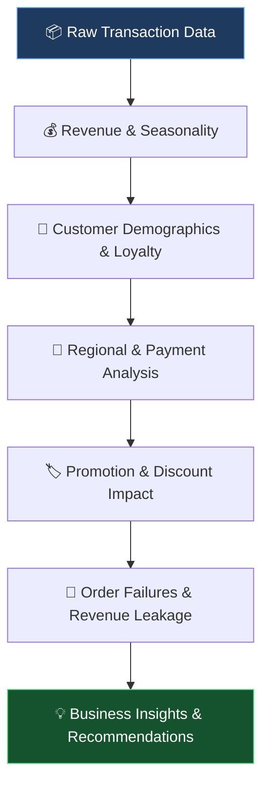

# 🛒 E-Commerce Transaction Insights Hub
### Turning Retail Transaction Data into Actionable Business Intelligence

<p align="center">
  <strong>📊 Data Analytics | 🐍 Python | 💰 Revenue Intelligence | 🚨 Fraud & Operational Risk</strong>
</p>

---

## 📌 Project Overview

**What if a retailer is generating millions in revenue while silently losing money through discounts, cancelled orders, and broken payment channels?**

The **E-Commerce Transaction Insights Hub** is an end-to-end exploratory data analysis project built using **Python in VS Code and Jupyter Notebooks**. It investigates retail transaction data to uncover revenue opportunities, customer purchasing patterns, promotional inefficiencies, and operational weaknesses.

Through five interconnected analytical pillars, this project transforms raw transaction records into actionable insights that can help businesses improve profitability, optimize promotions, strengthen payment reliability, and reduce revenue leakage.

🎯 **The mission:** Move beyond descriptive statistics to uncover the *why* behind retail performance and identify where business improvements can deliver the greatest impact.

---

## 🧰 Technology Stack

<p>
  
  
  
  
  
  
</p>

**Development Environment:** Visual Studio Code · Jupyter Notebooks

---

## 🗺️ Analytical Framework

The project follows a structured analytical workflow, moving from raw transaction data to business recommendations.



---

## 📊 The Five Analytical Pillars

### 1. 💰 Revenue Trends & Seasonality

**Business question:** When does the business generate the most revenue, and which product categories drive its performance?

**Analytical approach**
- Standardized transaction dates using `pd.to_datetime()`.
- Analyzed monthly and seasonal revenue patterns.
- Compared product category performance across high-performing periods.
- Identified periods and categories associated with sales surges.

**Business value:** Supports inventory planning, seasonal marketing campaigns, and more informed sales forecasting.

### 2. 👥 Customer Demographics & Loyalty

**Business question:** How do customer age groups and purchasing lifespans influence average spending?

**Analytical approach**
- Segmented customers into age groups using `pd.cut()`.
- Evaluated Average Order Value (AOV) across demographic segments.
- Applied multi-metric aggregations using `.agg()`.
- Compared purchasing patterns across customer groups.

**Business value:** Helps businesses identify valuable customer segments and develop more targeted retention and marketing strategies.

### 3. 📍 Regional Performance & Payment Preferences

**Business question:** Which geographic markets perform best, and which payment methods do their customers prefer?

**Analytical approach**
- Ranked geographic regions by transaction performance.
- Identified leading markets using `.head(3)`.
- Filtered regional subsets with `.isin()`.
- Examined payment method distributions across high-volume locations.

**Business value:** Helps prioritize regional marketing investment, localize payment options, and improve the customer checkout experience.

### 4. 🏷️ The Promotion & Discount Paradox

**Business question:** Do deeper discounts generate sustainable growth, or do they sacrifice revenue for larger baskets?

**Analytical approach**
- Evaluated relationships between discounts, basket sizes, and revenue.
- Used Pearson correlation through `.corr()`.
- Grouped transactions into discount tiers.
- Visualized discount relationships and linear trends using Seaborn's `regplot()`.

**Business value:** Identifies promotional strategies that balance transaction volume, customer demand, and revenue retention.

### 5. 🚨 Order Fulfillment & Revenue Leakage

**Business question:** Where are failed transactions, cancelled orders, and returns putting revenue at risk?

**Analytical approach**
- Standardized transaction status and payment method values.
- Isolated cancelled and returned orders.
- Identified high-value products associated with failed transactions.
- Used custom `lambda` functions to calculate failure and cancellation rates.
- Compared payment gateway performance to identify potential checkout bottlenecks.

**Business value:** Helps prioritize payment troubleshooting, investigate operational weaknesses, and reduce preventable transaction losses.

---

## 🔥 Key Discoveries & Business Intelligence

The analysis revealed several important patterns in promotional performance and operational reliability.

### 💸 Discovery 1: The Promotion Paradox

**The 11–20% discount tier emerged as a leading revenue-generating segment.**

| Performance indicator | Analytical finding |
|---|---:|
| Discount tier | 11–20% |
| Revenue reported | **$69.6 million** |
| Transaction count | **48,120** |
| Deep-discount basket size | **10.23 items** |
| Markdown value at 51–75% | **$1.30 million** |
| Net revenue retained in the 51–75% tier | **$918,000** |

**What this means**

- **Moderate discounts:** The 11–20% tier generated substantial reported revenue and warrants further investigation as a promotional strategy.
- **Deep discounts:** The 51–75% tier recorded larger average baskets, but the reported markdown value exceeded the net revenue retained.
- **Strategic implication:** Promotional success should be evaluated using revenue, discounts, product costs, and contribution margin—not basket size alone.

> 💡 **Recommendation:** Test targeted moderate-discount campaigns against deeper promotions and compare their incremental contribution margins before scaling them.

*Note: Revenue generation alone does not establish profitability. Product costs, operating expenses, and the precise definition of the markdown metrics must be considered before classifying any tier as the most profitable.*

### 🚨 Discovery 2: A Significant Cancellation Problem

**Reported cancellation rate: 39.17%**

More than 39% of incoming transactions were cancelled in the analyzed dataset.

**Why it matters**
- Potential lost sales and avoidable processing costs.
- Possible friction in checkout or payment authorization.
- The need to investigate customer cancellations, technical failures, and suspicious transaction activity separately.

**Recommendation:** Build a cancellation-monitoring dashboard segmented by payment method, product, region, and order status to identify the strongest drivers of failed transactions.

### 💎 Discovery 3: High-Value Product Exposure

Certain products beginning with the `MATSAM` prefix were associated with substantial cancelled or returned order values.

One highlighted SKU was:

`MATSAM5B10F7E2AC8C1`

**Reported associated transaction value: $6.54 million**

This makes the SKU a priority candidate for transaction-level investigation.

**Recommendation:** Validate the underlying order records, distinguish cancelled orders from completed sales, and quantify the actual recoverable revenue before estimating financial losses.

### 💳 Discovery 4: Payment Gateway Reliability Concerns

| Payment method | Reported cancellation rate |
|---|---:|
| `bankalfalah` | **95.7%** |
| `Easypay` | **82.5%** |

These unusually high reported rates suggest that the affected payment channels warrant immediate investigation.

Potential causes include payment integration problems, authorization failures, inconsistent status tracking, or suspicious transaction activity. The analysis alone does not establish the root cause.

**Recommendation:** Audit gateway logs, compare failure rates across time periods, and separate technical declines from customer-initiated cancellations and other failed states.

---

## 🧠 Python & Data Analytics Skills Demonstrated

This project demonstrates practical application of:

- **Data cleaning and preprocessing:** Datetime conversion, string standardization, and transaction filtering.
- **Exploratory data analysis (EDA):** Identifying patterns, outliers, and unusual business behavior.
- **Data aggregation:** Using `groupby()`, `.agg()`, and `.corr()` to extract meaningful metrics.
- **Feature engineering:** Creating customer age bands, discount tiers, and transaction failure indicators.
- **Statistical analysis:** Investigating correlations and relationships between promotional variables.
- **Data visualization:** Using Matplotlib and Seaborn to communicate trends and comparisons.
- **Business intelligence:** Translating analytical findings into practical recommendations.
- **Operational risk analysis:** Identifying products and payment channels that deserve further investigation.

---

## 🚀 Business Recommendations

| Priority | Recommended action | Expected business value |
|---|---|---|
| 🔴 High | Investigate payment gateways with extreme cancellation rates | Improve checkout reliability |
| 🔴 High | Audit high-value cancelled and returned orders | Quantify potential revenue recovery |
| 🟠 Medium | Evaluate moderate versus deep discount strategies | Improve promotional efficiency |
| 🟠 Medium | Monitor cancellation rates by region and product | Identify recurring operational issues |
| 🟢 Ongoing | Track customer segments and seasonal trends | Support targeted marketing and planning |

---

## 📁 Project Structure

```text
E-Commerce-Transaction-Insights-Hub/
│
├── data/
│   └── transactions.csv
│
├── notebooks/
│   └── ecommerce_transaction_analysis.ipynb
│
├── visuals/
│   └── analysis_charts/
│
├── README.md
└── requirements.txt
```

*Illustrative structure: adjust the filenames and folders to match the actual contents of your repository.*

---

## ⚙️ Getting Started

### Prerequisites

- Python 3.8 or later
- Visual Studio Code
- Jupyter extension for VS Code

### Installation

**1. Clone the repository**

```bash
git clone https://github.com/YOUR-USERNAME/YOUR-REPOSITORY.git
cd YOUR-REPOSITORY
```

**2. Create and activate a virtual environment**

```bash
python -m venv .venv
```

On Windows:

```bash
.venv\Scripts\activate
```

**3. Install dependencies**

```bash
pip install pandas numpy matplotlib seaborn jupyter
```

**4. Launch Jupyter Notebook**

```bash
jupyter notebook
```

Open the analysis notebook, update the dataset path if necessary, and execute the cells sequentially.

**Important:** Ensure that the dataset is available locally and that any sensitive transaction or customer information has been removed before sharing the project publicly.

---

## 🎯 Project Outcome

The E-Commerce Transaction Insights Hub demonstrates how Python-based data analytics can reveal patterns that basic reporting may overlook.

By combining revenue analysis, customer segmentation, regional comparisons, promotional evaluation, and operational risk investigation, the project provides a foundation for more informed retail decisions.

**The central takeaway:** Revenue growth matters, but sustainable business performance also depends on understanding discount efficiency, payment reliability, and the true financial impact of failed transactions.

---

## 👨‍💻 About the Analyst

**Kevin Kipyegon Korir | Data Analyst**

Passionate about transforming raw data into meaningful insights that support evidence-based decision-making. Focused on Python, exploratory data analysis, data visualization, and business intelligence.

🔗 **Connect with me:** [LinkedIn](https://www.linkedin.com/in/kevin-datainsights-7bb23625b)

💼 **Explore my work:** [GitHub Profile](https://github.com/Kevinkorir26)

---

⭐ **If you find this project interesting, consider starring the repository!**

*Turning data into insights. Turning insights into impact.*

• IDE: Visual Studio Code (VS Code)
• Environment: Jupyter Notebooks (.ipynb)
• Core Processing Data Library: Pandas
• Visualization Engine: Matplotlib & Seaborn
